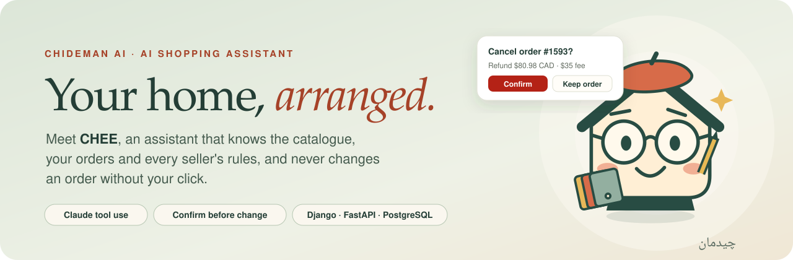
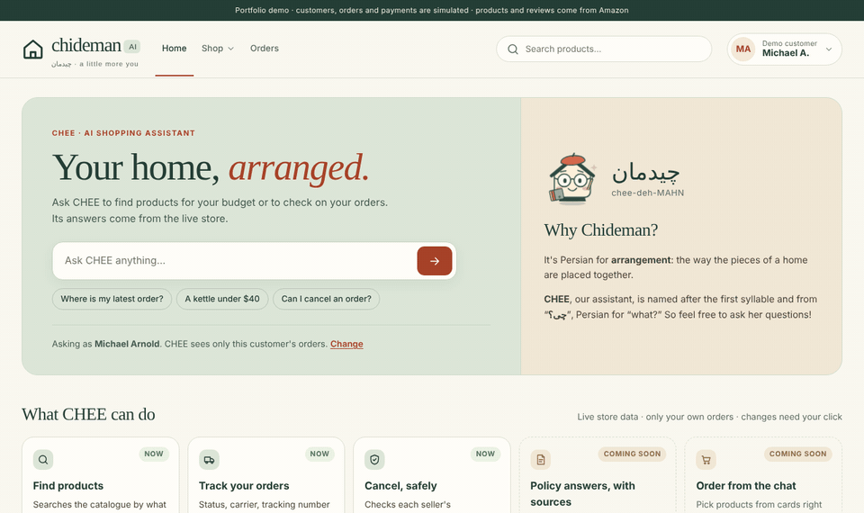
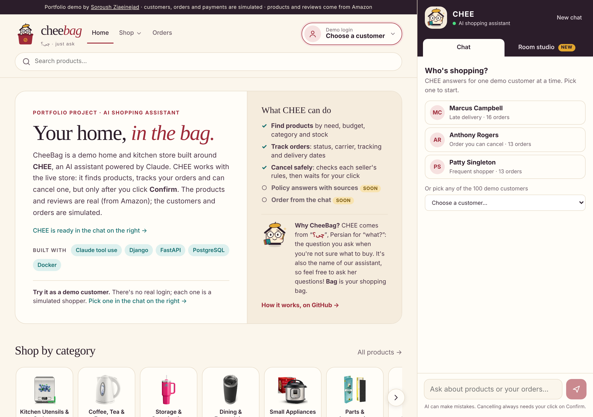
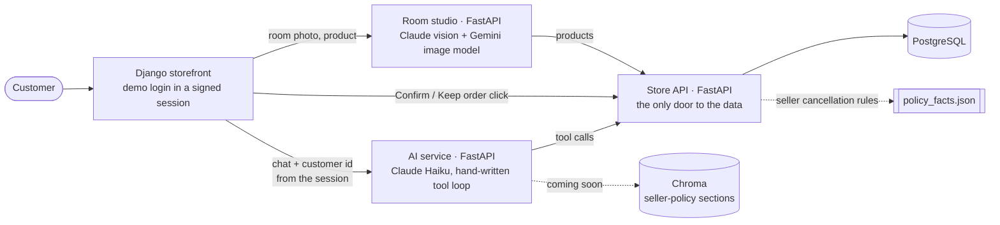
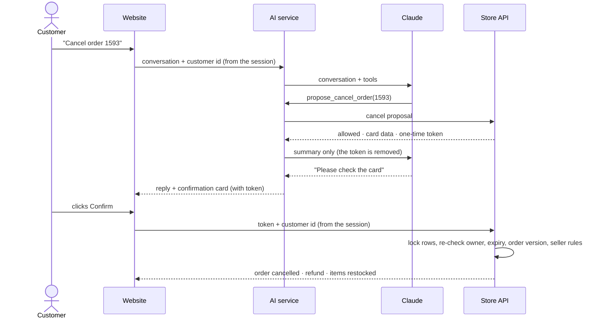
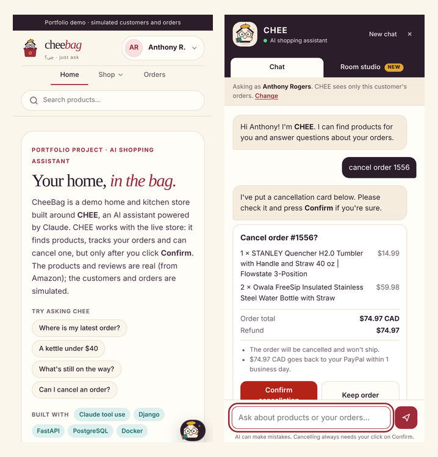

<p align="center">
  
</p>

<p align="center">
  
  
  
  
  
  
</p>

<p align="center">
  <b>A home and kitchen store with an AI assistant that can actually do things, safely.</b><br>
  <b><a href="https://chidemanai.com">Try the live demo at chidemanai.com →</a></b><br>
  <sub>Portfolio project · pick a demo customer and ask CHEE</sub>
</p>

---

**CheeBag** is a full-stack demo store built around **CHEE**, a shopping assistant powered by Claude. CHEE doesn't just chat: it searches the live catalogue, looks up the signed-in customer's orders, and can cancel an order, but only after the customer presses a button that the model itself can never press.

<p align="center">
  
</p>

## Meet CHEE

**CHEE** comes from **⁧چی؟⁩** (chee), Persian for "what?": the question you ask when you're not sure what to buy. **Bag** is your shopping bag. So the name is the whole idea: ask CHEE, and the right things end up in your bag.

| | What CHEE can do |
|---|---|
| ✅ **Find products** | Searches the catalogue by need, budget, category and stock, and only mentions products the store really has. |
| ✅ **Track orders** | Status, carrier, tracking number and delivery dates, for the signed-in customer's orders only. |
| ✅ **Cancel, safely** | Checks every seller's cancellation rules, shows a confirmation card with the refund and any fee, and changes nothing until the customer clicks **Confirm**. |
| ✅ **Room studio** | Upload a photo of your room: CHEE describes its style and colours, shows products in it (an AI preview made with Google's Gemini image model) that you can move and recolour, picks a set for your budget, and suggests what else would suit it, from CheeBag's catalogue or from 14 Canadian online shops (via Google Shopping). |
| 🔜 **Policy answers with sources** | Returns, shipping and warranty questions answered from each seller's policy PDF, citing the section and page (RAG). |
| 🔜 **Order from the chat** | Pick products from cards in the chat and place a demo order after confirming. |

<p align="center">
  
</p>

## How it works



- **Five small services in Docker Compose**: the Django storefront, the AI service, Room studio, the Store API and PostgreSQL, with Caddy in front in production.
- **The agent loop is written by hand** on the Anthropic Messages API (no LangChain), so every tool call, error and token count is visible. Each answer shows which tools CHEE used.
- **The model never decides who you are.** The customer id comes from the server-side session and is added to every tool call by the backend. Tool arguments are validated again in code, because model output is untrusted.
- **The Store API owns every business rule.** Ownership is part of each query, so another customer's order is simply "not found".

## Changes need a human click

Cancelling an order is the first action CHEE can take, and it is built so that a confused or manipulated model still can't do damage:



- **Claude can only propose.** There is no confirm tool; the only path that changes an order is the button.
- **The token never reaches the model.** The agent strips it from the tool result before Claude sees it, and the database stores only its SHA-256 hash.
- **Single use, 10 minutes, owner only.** A replayed, expired, forged or someone else's token is refused.
- **Safe against double clicks and races.** Rows are locked, a repeated confirm returns the first result, and if the order changed since the proposal (for example it shipped), nothing happens.
- **The rules come from the sellers' own policies.** Copperline cancels free while an order is pending, Kettle & Crema within 2 hours, Breezeway charges a $35 fee after 12 hours. CHEE explains the reason when it can't cancel.
- **Everything is logged** in an append-only `order_events` table.

<p align="center">
  
</p>

## The data

- **218 products and 15,631 reviews**, a home and kitchen subset of [Amazon Reviews 2023](https://amazon-reviews-2023.github.io/) (McAuley Lab, UC San Diego): 136 kitchen and home products, plus 82 pieces of furniture, decor, lamps and TVs for Room studio (`data/src/add_furniture.py`).
- **6 fictional sellers**, four in Canada and two in the US, each with its own 11–13 page policy handbook (PDF) for returns, shipping, warranty and cancellation.
- **100 customers and 800 orders**, generated with Faker. 60% have Canadian addresses, and the orders include payments, shipments and late deliveries.
- **Prices in Canadian dollars**, with shipping across Canada and the USA.

The policy PDFs, their ground-truth values and a validator (49 checks) are generated from one source file, so the documents, the cancellation rules and the future RAG evaluation can never disagree. Data quality is checked with `data/postgreSQL/checks.sql`.

## Run it locally

You need Docker and an [Anthropic API key](https://console.anthropic.com/).

```bash
git clone https://github.com/soroush-ziaeinejad/CheeBag.git cheebag
cd cheebag
cp .env.example .env          # then add your ANTHROPIC_API_KEY (and GEMINI_API_KEY for real room previews)
docker compose up -d --build
```

| URL | What |
|---|---|
| http://localhost:8000 | The store. Pick a demo customer in the header, then ask CHEE. |
| http://localhost:8001/docs | Store API (interactive docs) |
| http://localhost:8002/docs | AI service (interactive docs) |
| http://localhost:8003/docs | Room studio (interactive docs) |

The database builds itself from the CSVs on first start. To reset the demo data: `docker compose down -v && docker compose up -d`.

## Project structure

```
├── frontend/        Django storefront: pages, demo login, chat drawer, confirmation cards
├── agent/           AI service: Claude tool loop, tool definitions, typed UI payloads
├── room_studio/     Room studio: room photos, Claude's room analysis and suggestions, product previews
├── store_api/       Store API: products, orders, cancel proposals and confirmations
├── data/
│   ├── src/         data pipeline: products, sellers, customers and orders, policy PDFs
│   ├── policies/    seller policy PDFs, manifest and ground truth
│   └── postgreSQL/  schema, loader, migrations, data checks
├── tests/
├── docker-compose.yml        local development
└── docker-compose.prod.yml   production (Caddy, no exposed internals)
```

## Roadmap

- [x] Storefront with demo customers and a mobile-friendly layout
- [x] Tool-calling assistant for products and orders
- [x] Cancel with a confirmation card, server-side checks and per-seller rules
- [x] HTTPS deployment on AWS ([chidemanai.com](https://chidemanai.com))
- [ ] Seller-policy RAG with citations (Chroma, all-MiniLM-L6-v2, seller filtering before search)
- [ ] RAG evaluation: section recall@k, wrong-seller rate, groundedness, tokens and latency
- [ ] Order from the chat with product cards and the same confirmation flow
- [ ] Automated test suite

## About

Built by [Soroush Ziaeinejad](https://github.com/soroush-ziaeinejad), PhD in Computer Science.

Room studio's sample room photo is by [Salvo Media](https://unsplash.com/photos/empty-room-with-white-walls-hardwood-floor-and-high-windows-bG8rvtDeExE) on Unsplash.

This is a portfolio demo. Customers, orders, payments and sellers are fictional, and the seller policies are demonstration documents, not legal terms.
